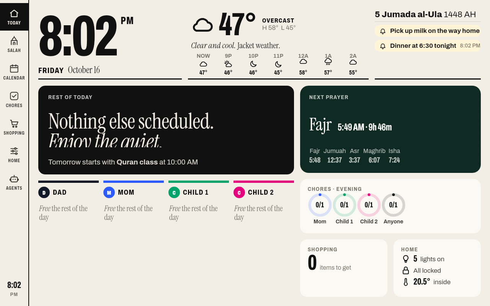
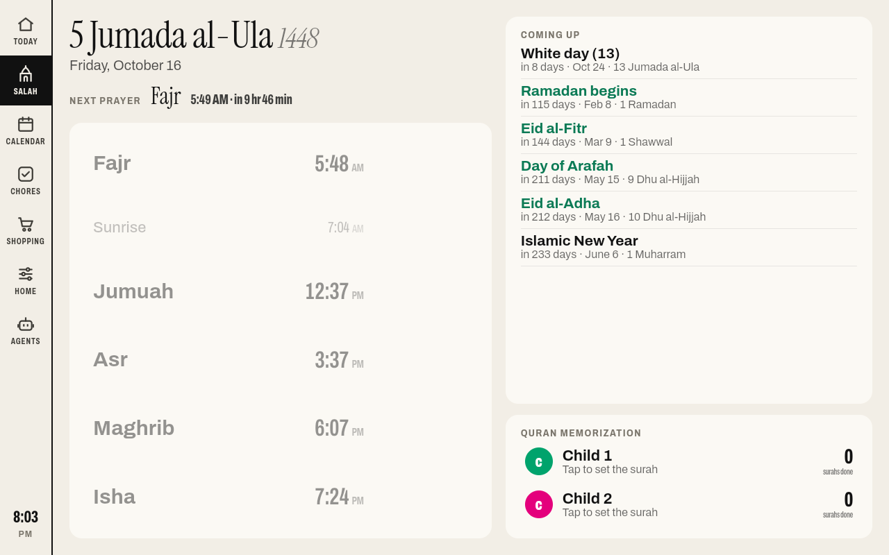
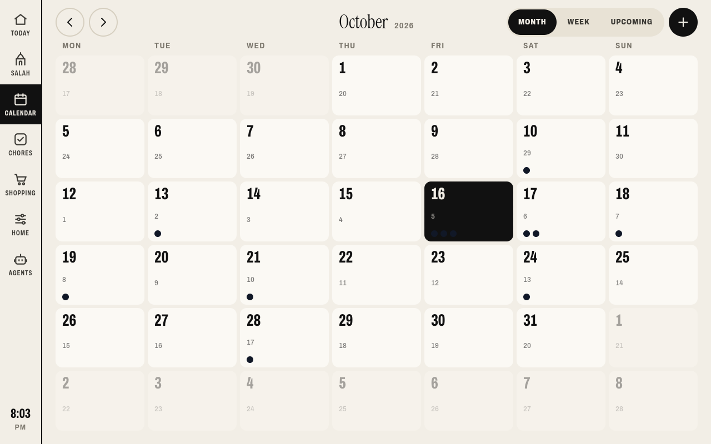
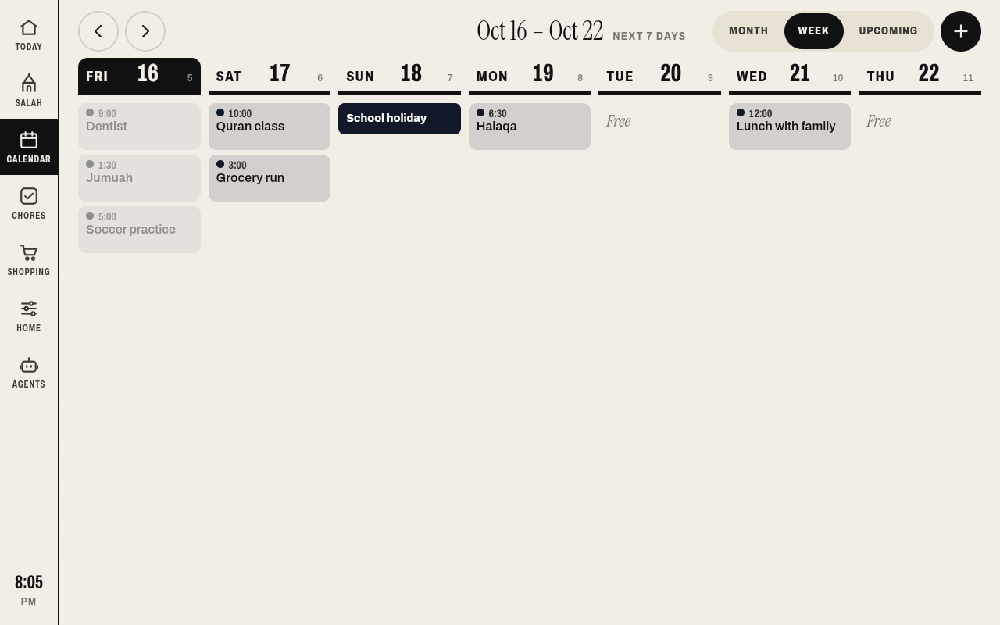
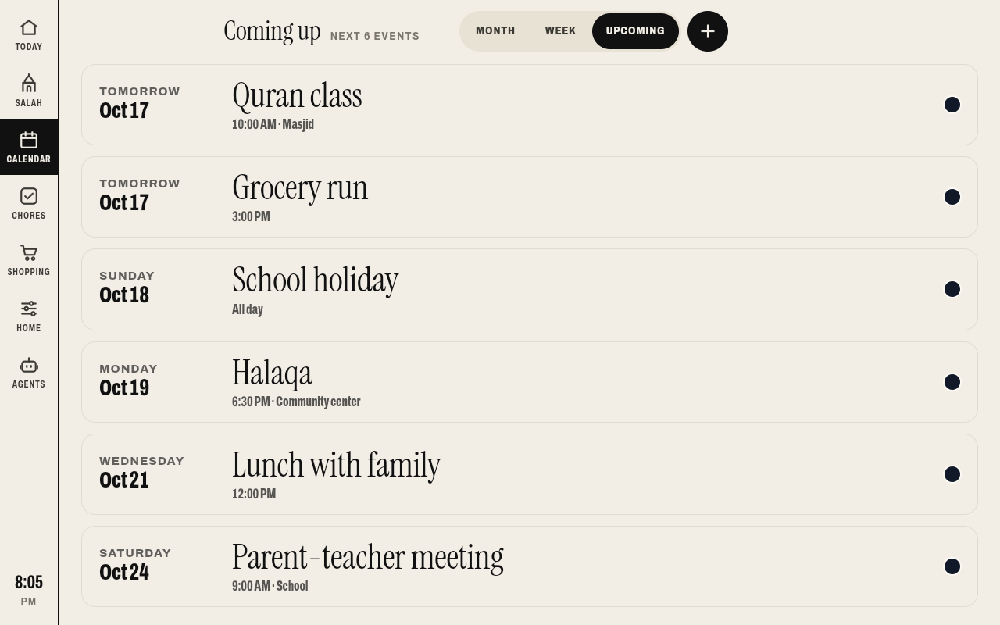
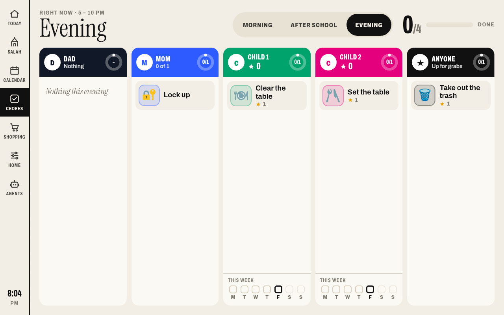
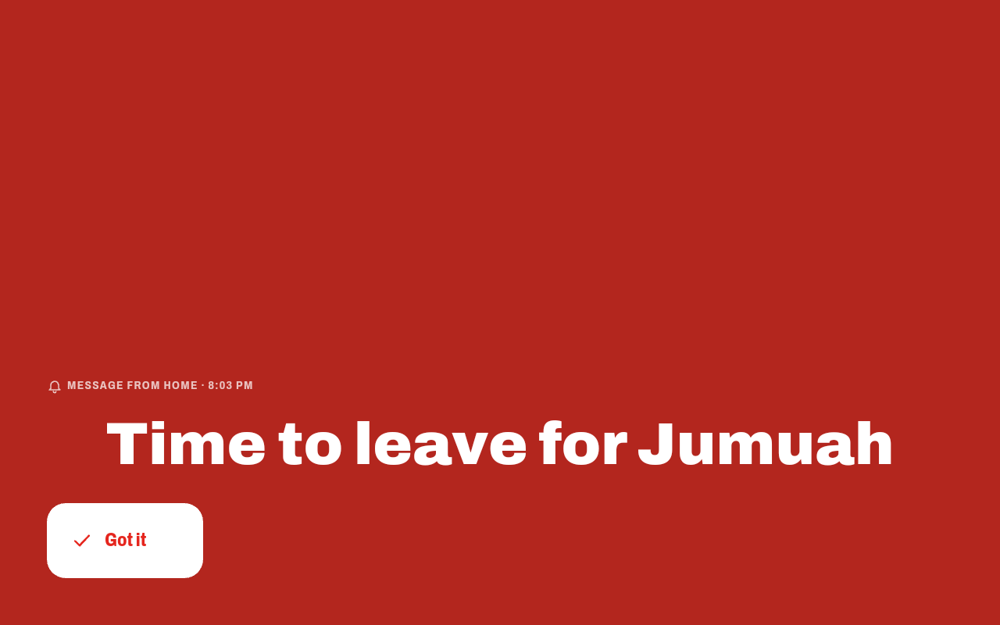
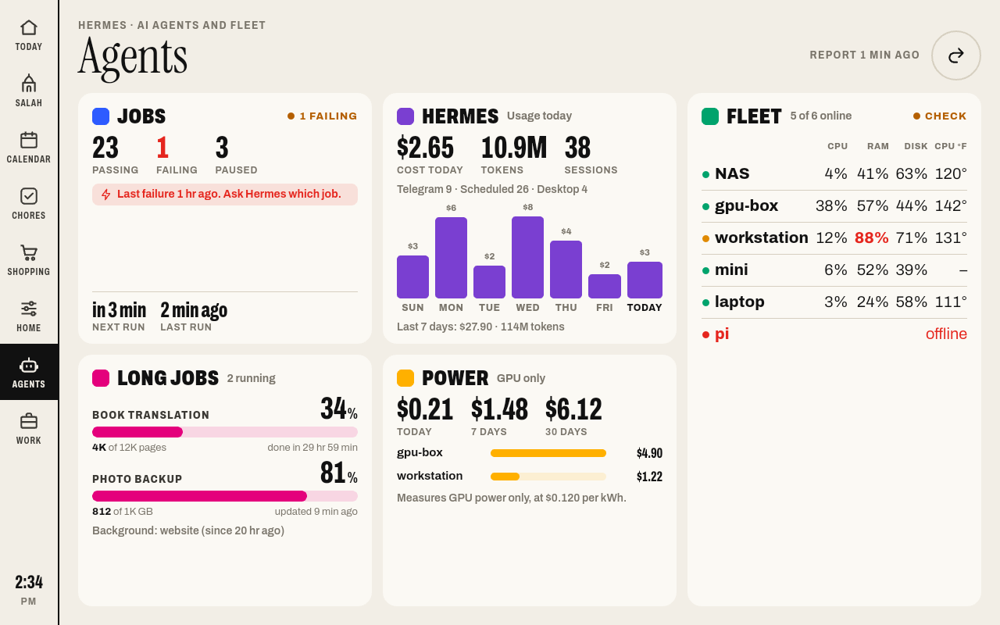
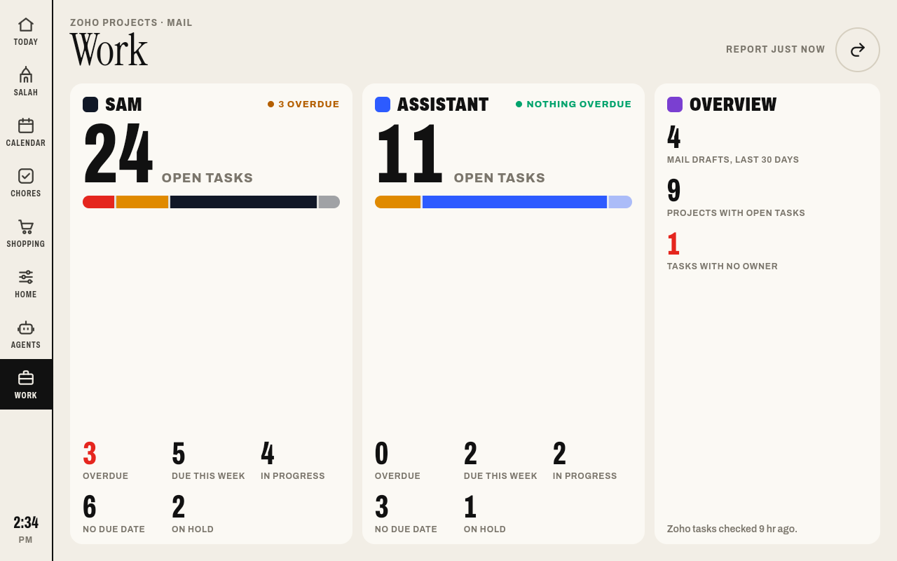

# Family Frame

A family dashboard for an AiMOR photo frame, with prayer times and the Adhan, a Hijri date,
a shared calendar, chores, a shopping list and a message board. It is built on the dashboard
in [wesbos/photo-frame-dashboard](https://github.com/wesbos/photo-frame-dashboard) and runs
on the frame's kiosk app from that repo.

All data stays on your home network. The frame loads the page from a small server on your
LAN, and the server stores the shared state in one JSON file.

## What it adds to the upstream dashboard

- Salah tab with the five prayer times, the next prayer, and a countdown. Fajr plays its own
  Adhan, and each prayer has a volume setting.
- Prayer times computed on the frame with [adhan](https://github.com/batoulapps/adhan-js)
  (ISNA method, Shafi or Hanafi Asr), and on the server by `server/prayer.py`, a stdlib
  Python port of the same algorithm. The port matched adhan-js exactly on 48 test dates
  across 2026 and 2027.
- Hijri date (Umm al-Qura calendar).
- Calendar tab with Month, Week and Upcoming views. Events come from a Google calendar
  (`server/frame_calendar_push.py`) or from private ICS links.
- Full-screen alert with a chime, and a message board, sent from any computer with
  `server/frame_post.py`.
- Weather from Open-Meteo, cached by the server.
- Parent panel: hold the sidebar clock for 1.5 seconds to test the Adhan, set the volume,
  or reload.

## Screenshots

These were taken on the frame itself with `adb exec-out screencap`, running the code in this
fork with sample data (Dad, Mom, Child 1, Child 2, Chicago).

| Today | Salah |
|---|---|
|  |  |

| Calendar, month | Calendar, week |
|---|---|
|  |  |

| Calendar, upcoming | Chores |
|---|---|
|  |  |

| Full-screen alert |
|---|
|  |

## Messages from Hermes Agent

We run [Hermes Agent](https://github.com/NousResearch/hermes-agent) on a computer at home and
talk to it on Telegram. Hermes can send to the frame in two ways:

1. A Telegram message to Hermes that starts with `#alert` puts the rest of the text on the
   frame as a full-screen red alert with a chime. It stays until someone taps "Got it". A
   message that starts with `#frame` adds a line to the message board on the Today page.
   `#frame clear` empties the board, and `#alert off` removes the alert. Hermes runs
   `server/frame_post.py`, which posts to the frame server with the `X-Frame-Token` header.
   Hermes then reacts with ✅, or replies with the error if the post failed.
2. A scheduled task runs `server/frame_calendar_push.py` every 10 minutes. It reads the
   Google calendar through the same Google token Hermes uses, and sends the events from 45 days ago to 60 days ahead to
   the frame. Events marked private show as "Busy".

The two scripts do not need Hermes. Any program that can run a command, or send an HTTP POST
with the token, can send alerts and messages the same way.

## Agents and Work tabs

Two tabs report on the AI agents, the computers at home, and open work. A script on the
computer that runs Hermes, `server/frame_agents_push.py`, collects a report every 5 minutes
and posts it to the frame server. Both tabs show counts only. No client names, task titles,
mail subjects or job names reach the frame.

| Agents | Work |
|---|---|
|  |  |

The screenshots use sample data from `scripts/sample-agents-report.py`.

The Agents tab has five cards:

1. Jobs: how many Hermes scheduled jobs pass, fail or are paused, and when the next one runs.
2. Hermes: cost, tokens and sessions today, where the sessions came from, and the last 7 days.
3. Fleet: each computer from [homelab-monitor](https://hub.docker.com/r/sikamikaniko123/homelab-monitor),
   with CPU, RAM, disk and CPU temperature in °F.
4. Long jobs: a progress bar for any job that writes a progress file (see below), and the
   Hermes background processes.
5. Power: measured power cost per computer. The monitor measures GPU power only.

The Work tab shows open Zoho Projects tasks for up to two people (overdue, due this week, in
progress, no due date, on hold), the number of mail drafts from the last 30 days, and the
number of projects with open tasks.

Settings go in the environment or in the Hermes `.env` file:

| Setting | Example | Purpose |
|---|---|---|
| `FRAME_HOMELAB_MCP` | `https://nas.example.ts.net:9810/mcp` | homelab-monitor MCP address |
| `FRAME_HOST_LABELS` | `local=NAS,desktop=mini` | rename computers |
| `FRAME_SAFE_CWD` | `c:\projects` | folders whose name may show for a background process |
| `FRAME_ZOHO_SNAPSHOT` | `C:\state\zoho-tasks.json` | nightly list of Zoho tasks |
| `FRAME_WORK_PEOPLE` | `Sam=Sam;Alex=Assistant` | Zoho owner name and card label |
| `FRAME_DRAFTS_LABEL` | `mail drafts, last 30 days` | label for the drafts count |
| `GOOGLE_TOKEN_FILE` | `google_token.json` | Gmail token for the drafts count |

A long job gets a progress bar when it writes a file such as the example below to `hermes/state/frame-progress/<id>.json`.

```json
{"name": "Book translation", "done": 4120, "total": 12000, "unit": "pages", "eta": "2026-10-20T18:00:00-05:00"}
```

## Layout

```
web/                 the dashboard (Vite, plain JavaScript, targets Android WebView 106)
  js/family.js       your household: people, colours, chores, location
  js/deen.js         prayer times, Adhan, Hijri date, alerts, sync with the server
  js/views/salah.js  the Salah tab
server/
  server.py          stdlib HTTP server: serves the page and the JSON API
  prayer.py          prayer-time calculation (port of adhan-js 4.4.6)
  docker-compose.yml runs server.py in python:3.12-alpine
  frame_post.py      send an alert or a message to the frame
  frame_calendar_push.py  push Google calendar events to the frame
scripts/fetch-audio.py    download the Adhan recordings and make the chime
docs/frame-setup.md       notes on rooting the PF1007L and installing the kiosk
deploy.sh            build the page and deploy it over SSH
```

## Setup

1. Edit `web/js/family.js`: names, colours, chores, and your location (`lat`, `lon`).
2. Get the audio. You need ffmpeg on your PATH.
   ```
   python scripts/fetch-audio.py
   ```
3. Build the page.
   ```
   cd web && npm ci && npx vite build
   ```
4. On the server host, make a folder (for example `/srv/family-frame`) and copy
   `server/.env.example` into it as `.env`. Set `FRAME_TOKEN` to a long random string, and
   set `LAT`, `LON`, `TZ_NAME` and `MADHAB`. Run `chmod 600 .env`.
5. Deploy from your computer:
   ```
   DEPLOY_HOST=<ssh host> DEPLOY_DIR=/srv/family-frame bash deploy.sh
   ```
   The last line prints `{"ok": true}` when the server is up on port 8098.
6. Point the frame's kiosk at `http://<server-ip>:8098/` (see `docs/frame-setup.md`).

## Sending alerts and messages

Put `FAMILY_FRAME_URL=http://<server-ip>:8098` and `FAMILY_FRAME_TOKEN=<your FRAME_TOKEN>`
in the environment or in `server/.env` on the computer that sends.

```
python server/frame_post.py alert "Dinner is ready"   # full-screen until someone taps Got it
python server/frame_post.py message "Soccer at 5"     # a line on the message board
python server/frame_post.py clear                     # clear the message board
python server/frame_post.py dismiss                   # clear the alert
```

## Google calendar

`server/frame_calendar_push.py` reads an authorized-user token file (`GOOGLE_TOKEN_FILE`,
default `server/google_token.json`) with Calendar read access. It sends 45 days back and 60
days ahead. Events marked private show as "Busy". Run it every 10 minutes with cron or a
scheduled task. It needs `google-api-python-client` and `google-auth`.

## API

| Method | Path | Purpose |
|---|---|---|
| GET | `/api/health` | `{"ok": true}` |
| GET | `/api/state` | shared state: shopping, chores, stars, Quran progress, messages, alert |
| POST | `/api/state/<key>` | replace one state key from the frame |
| GET | `/api/prayer` | today's and tomorrow's prayer times in `TZ_NAME` |
| GET | `/api/weather` | Open-Meteo forecast, cached 20 minutes |
| GET | `/api/calendar` | calendar events |
| POST | `/api/calendar/push` | receive events (needs `X-Frame-Token`) |
| POST | `/api/alert`, `/api/message`, `/api/message/clear` | needs `X-Frame-Token` |
| POST | `/api/alert/dismiss` | clear the alert |

The server is meant for a home LAN only. Do not expose port 8098 to the internet.

## Credits

- Dashboard, kiosk app and frame research: [Wes Bos, photo-frame-dashboard](https://github.com/wesbos/photo-frame-dashboard).
- Prayer-time algorithm: [batoulapps/adhan-js](https://github.com/batoulapps/adhan-js) (MIT).
- Adhan recordings: Quran Cube, archive.org item
  [adhanclock-qurancube](https://archive.org/details/adhanclock-qurancube). They are not
  stored in this repo; `scripts/fetch-audio.py` downloads them from the source.
